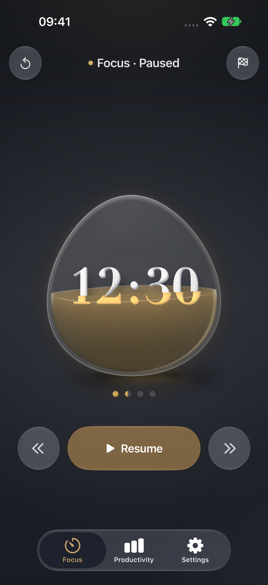
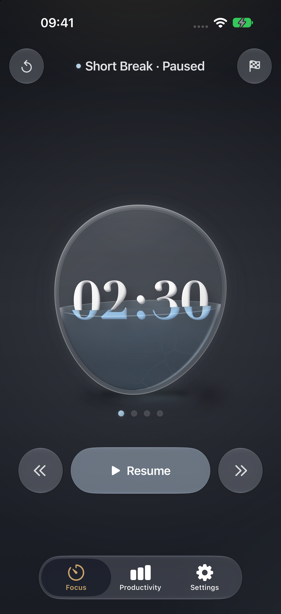
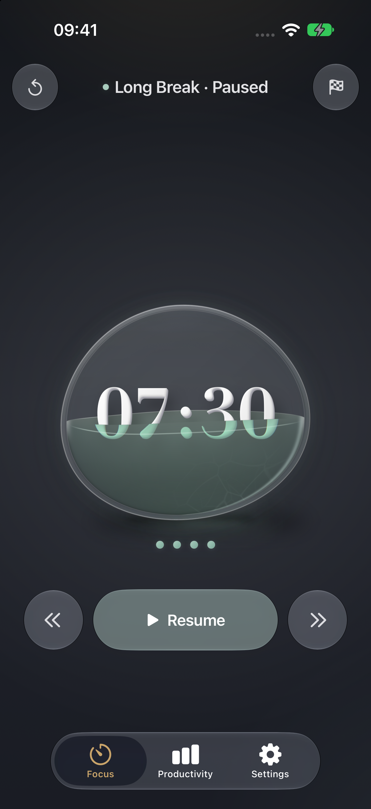
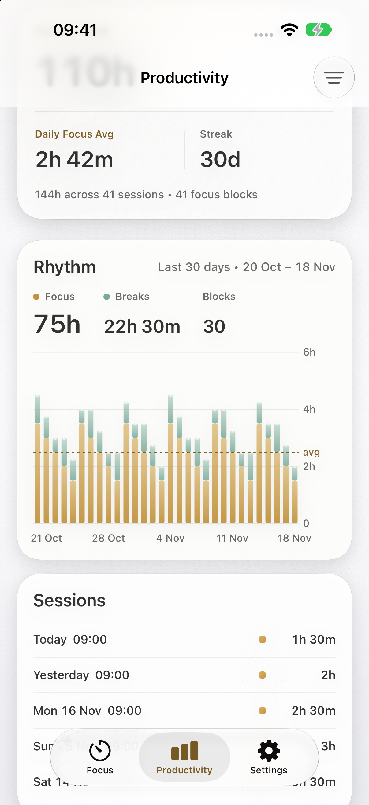
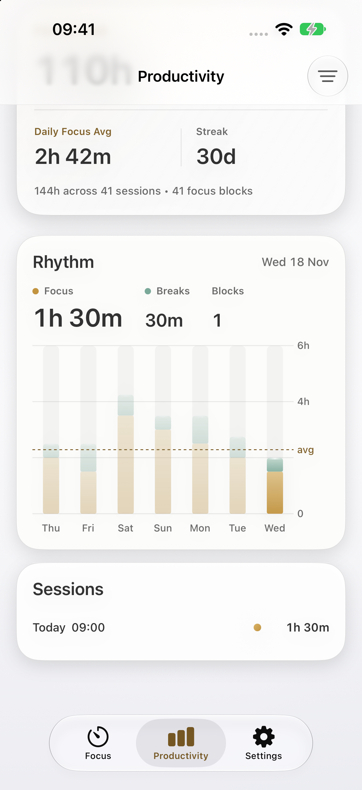
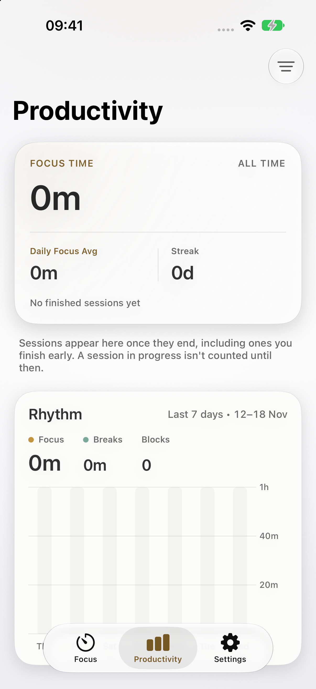

# Product Vision

I want a timer I can start and leave beside me while I work. So the countdown is big, and the actions I need often all fit on one screen. The vessel also changes shape with each phase, so one glance tells me where I am.

This document explains the decisions behind the app and what isn't done yet. Setup is in the [README](README.md), and the [screenshot gallery](docs/screenshots/README.md) has more states.

The app has three pages, Focus, Productivity and Settings, and everything stays on the device. On iPhone it only runs in portrait. In landscape the top of the vessel got cut off and the controls slid under the tab bar. A layout for a phone on a desk stand needs its own design, so I locked the orientation for now.

## The vessel

| Phase | Default | Shape | Color |
| --- | --- | --- | --- |
| Focus | 25 min | Upright drop, full low down and gathered toward the top | Amber Gold |
| Short Break | 5 min | Rising bubble, wider high up and gently leaning | Soft Mist |
| Long Break | 15 min | Broad, low vessel at rest | Soft Jade |

Focus is taller than it is wide, so it can't be mistaken for the long break. All three stand on the same baseline, and the liquid fills each one from its own bottom to its own top.

Making it look like glass came down to a lot of small things. An early outline bent sharply where its curves met and looked cut, so the outlines now curve smoothly all the way around. The wall has visible thickness, and the liquid meets it with no gaps. Light comes from the upper left and casts a soft shadow to the lower right. A caustic in that shadow brightens as the vessel fills. Seen slightly from above, the surface is an ellipse with two layers of waves. The liquid gets deeper in color where light travels further through it.

In dark mode the amber read as tea, so the Focus liquid now keeps a little warmer light just below the surface. I kept it gentle. A stronger version pulled the submerged half of the digits down to about 2.7:1 contrast at mid fill, and this one keeps about 3.2:1. The breaks don't get it, since mist and jade don't turn brown in the dark.

| Focus | Short break | Long break |
| :---: | :---: | :---: |
|  |  |  |

The countdown is set in Didot Bold. It sits inside the glass as a thin solid, with a lit bevel and a soft shadow on the back wall. Below the surface the liquid tints and bends it. At the waterline that bend is only a small kink, never a second digit.

The surface moves slowly and stops on pause. When the phase changes, every layer of the vessel follows the same timing, so none of them reaches the new shape early. The vessel only fills completely during the last second, because looking full a few seconds early gives the wrong cue.

### Finishing in place

When a session ends, the vessel stays where it is and becomes the summary. The countdown turns into the focus time I recorded. The fill settles to the share of planned focus I actually did, just below the rim if I hit the plan. A session ended early says Session finished, with a short note that the work was kept. Done drains the vessel back to its starting level and turns back into Start.

FOCUSED, above the total, uses Didot's small capitals. It replaced SF Expanded Heavy caps, which read as a second voice next to the numerals. It's printed flat, because the 3D side striped its thin strokes at that size.

I left duration changes off the vessel. Dragging it could change the time by accident and would make timing and statistics messier. Finish early already covers stopping sooner. If I add extensions later, I'd start with explicit buttons like +5 min.

## Controls

The main button sits under the vessel, with Back and Skip on either side and Reset and Finish early at the top. Buttons that aren't useful yet disappear but keep their place, so the main button never moves.

Pause stays neutral, so the vessel stays the strongest color while a step runs. Start, Resume and Done get a light wash of the phase color. In dark mode that wash turned khaki over the glass, so on Focus it borrows the warmer amber from the liquid.

The status line adds Paused while a step is paused. Before that, a paused countdown and a running one looked the same at a glance. Tapping the background hides everything except the vessel. I don't dim the digits there, because numbers that stop changing are cue enough, and dimming would drop them below 3:1.

The labels on Focus grow with Dynamic Type up to the first accessibility size and then stop. The controls sit at fixed distances from the vessel, and anything bigger would run into it.

## Statistics

Every number on Productivity should be easy to explain. Only finished sessions count, and only time that actually ran. Paused time adds nothing, and a block only counts as completed if it ran its full length.

| Number | What it means |
| --- | --- |
| Focus Time | Time recorded in focus blocks |
| Breaks | Time recorded in short and long breaks |
| Session Time | Focus Time plus breaks |
| Blocks | Focus blocks that ran their full length |
| Daily Focus Avg | Focus time divided by the days that had any focus |
| Streak | Days in a row with focus. It holds through today and ends only after a whole day without focus. |

A session that crosses midnight is split between the two days. Lifetime totals stay in hours, so they can't be mixed up with the streak's days. With no history, Daily Focus Avg shows a dash, because 0m looked like a real average.

The Rhythm chart covers the last 7 days, 30 days or 12 months. Month is 30 daily bars. Weeks don't divide 30 days evenly, and a short last group could look like a drop in activity. Week and Year keep faint empty columns behind the bars so missing days keep their place. Month leaves them out, because thirty of them read as stripes. Tapping a bar shows that slot's figures and sessions. It's tap-only, so dragging over the chart still scrolls the page.

This page uses SF Pro with monospaced digits. Didot stays inside the vessel, because here it would add a second voice and crowd the numbers.

| Month | Selected day | Empty history |
| :---: | :---: | :---: |
|  |  |  |

## Reminders

A phase ending and the next one starting count as one event and get a single response. Moving on plays a whoosh, going back a pop, a reset its own sound, and the end of a session a thud. Coming back from the background never replays the sounds I missed.

When the app isn't in front, a notification marks each change and says what ended and what comes next:

| Moment | Title | Body |
| --- | --- | --- |
| Focus ends, short break starts | Focus complete | Short break, 5 min. |
| Short break ends, focus starts | Break over | Focus round 2 of 4, 25 min. |
| Final focus ends, long break starts | Focus complete | That was the last round. Long break, 15 min. |
| Long break ends | Session complete | 1h 40m focused · 4 of 4 focus blocks |

While the app is open, only its own sound and haptic play, so nothing happens twice.

I mark the notifications Time Sensitive. If an iOS Focus like Work holds a reminder back, a break passes without me noticing. That needs a paid developer account. I sign the app with a free one for now, so iOS delivers them as ordinary notifications.

The app asks for notification permission on the first Start, since nothing needs a reminder before that.

## Settings

All four rhythm settings use the same inline wheel, so choosing rounds works like choosing minutes. Rhythm changes apply from the next session, and everything else applies right away. Keep Screen On only holds while the timer runs, and its label says exactly that.

The switches are neutral gray. Amber already marks focus on this page, and four amber switches were the brightest thing on it. In light mode the gray also shows "on" more clearly than amber did.

Clearing the history removes finished sessions and statistics but keeps the current session and the settings.

## Look and feel

The vessel gives the app its identity, and I don't want anything competing with it. Navigation stays native, movement stays slow, and there are no rewards, check-ins, particles or constant wobbling.

Liquid Glass is only for controls that sit above content, like the tab bar, menus and the Focus buttons. Cards on Productivity and Settings use regular material, because their text needs a steady background.

The app icon uses the same three outlines. Nested, they read as a target or an eye, and arranged around the Focus shape they looked like an egg. Separate shapes rising at different heights read clearly as bubbles. Each is about 60% full, so the waterlines keep the icon recognizable even without color.

## What isn't done yet

- I haven't measured rendering, heat or energy use on a real iPhone 14 Pro. Haptics, sounds and lock-screen notifications still need checking on a device. Performance with a long history isn't measured either.
- SwiftData and iCloud sync aren't there yet. I want the time accounting and storage settled first, and the migration has to keep the accounting, deduplication and history clearing intact. iCloud would only cover finished sessions and some settings, never a running timer.
- Send Feedback and Share App are placeholders that say Soon.
- The native macOS and Live Activity experiments are shelved.
- Imported sounds, advanced analytics and more elaborate reminder rules aren't implemented.
- An interface built around animated numerals is still just an idea. The vessels stay until I pick a different direction.
