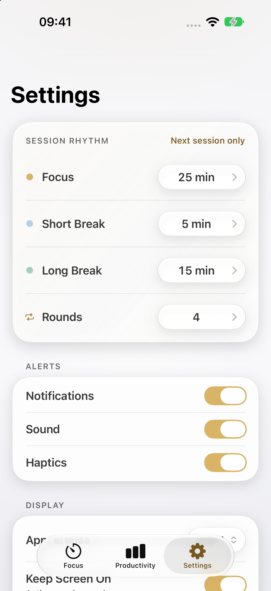
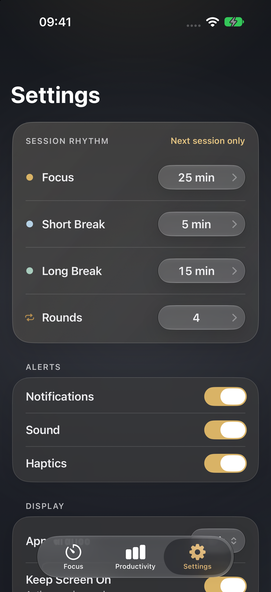
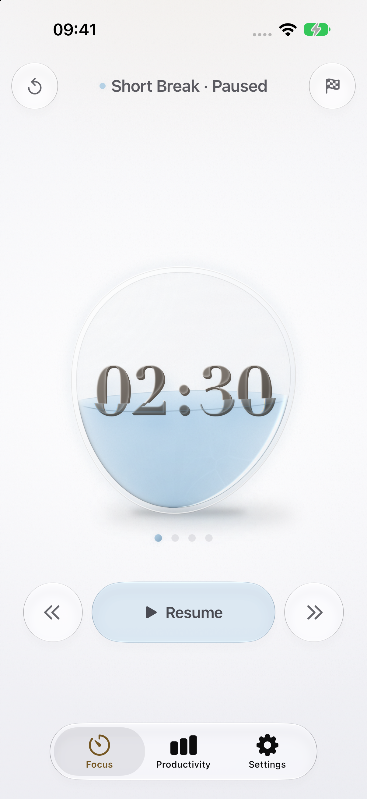

# Pomori

Pomori is an iOS Pomodoro timer I'm building in SwiftUI. The timer is a glass vessel that fills up as time passes, and the full focus and break cycle already works.

AI agents wrote the code. I do the UI design and the review, and many of the ideas are mine. I read up on SwiftUI along the way. The [design notes](docs/design-notes.md) explain the decisions behind it.

## Screenshots

| Focus | Productivity | Settings |
| :---: | :---: | :---: |
|  |  |  |
|  |  |  |

Simulator captures on an iPhone 18 Pro with iOS 27.2. The charts show generated test data. More states and the capture commands are in the [full gallery](docs/screenshots/README.md).

## What I focused on

A progress ring would have been simpler, but I wanted the timer to feel like an object on the page. The vessel is where most of my time went. The first version looked nothing like glass. It looked fake. It took a lot of back-and-forth with the agents, plus reference images I dug up, to get it to where it is now.

Each phase has its own shape, and all three stand on the same baseline so the vessel doesn't jump when the phase changes.

| Short break | Long break | Finished early |
| :---: | :---: | :---: |
|  |  |  |

The digits sit inside the glass, and a Metal shader lets the liquid tint and bend the part below the surface. When a session ends, the countdown turns into the focus total in the same vessel.

I also wanted the statistics to be easy to explain. If I skip a focus block after five minutes, those five minutes count, but the block doesn't. Paused time doesn't count at all. The summary leads with focus time instead of total time, so long breaks can't pad the number.

## Run locally

Built with Xcode 27.2 (27B52) for iOS 26.2 and later, with no package dependencies. The Xcode project still uses the repo's old name, VibePomodoro.

1. Open `VibePomodoro.xcodeproj` in Xcode.
2. Select the `VibePomodoro` scheme and an iPhone simulator running iOS 26.2 or later.
3. Build and run. For a physical device, select your own signing team first.

The shader needs Xcode's Metal Toolchain. If it's missing, run:

```bash
xcodebuild -downloadComponent MetalToolchain
```

To build from the command line:

```bash
xcodebuild \
  -project VibePomodoro.xcodeproj \
  -scheme VibePomodoro \
  -configuration Debug \
  -destination 'generic/platform=iOS Simulator' \
  build CODE_SIGNING_ALLOWED=NO
```

To run the unit and UI tests:

```bash
xcodebuild \
  -project VibePomodoro.xcodeproj \
  -scheme VibePomodoro \
  -destination 'platform=iOS Simulator,name=iPhone 18 Pro,OS=27.2' \
  test CODE_SIGNING_ALLOWED=NO
```

Change the destination if you don't have that simulator. The tests cover the session rules, statistics, persistence, reminders and the main screens.

## How it works

One `PomodoroStore` holds the state, and the engine decides what comes next. Screens only display state and send actions. The timer doesn't count seconds itself. It works out the time left from `targetEndDate`, so it stays right when the phone locks or the app restarts.

```text
VibePomodoro/
├── VibePomodoroApp.swift       Creates the single store
├── ContentView.swift          Shared shell and tab navigation
├── AppIcon.icon/              Icon Composer source
├── Core/
│   ├── Engine/                Session construction and transitions
│   ├── Models/                Settings, snapshots, archives, aggregates
│   └── Store/                 Runtime, persistence, notifications, feedback
├── Screens/
│   ├── Focus/                 Vessels, shader, controls, summary
│   ├── Productivity/          Summary, chart, session list
│   └── Settings/              Rhythm wheels and preferences
└── Shared/                    Reused theme and shell components
```

Data lives in UserDefaults for now. Settings, the active session, the history and the statistics cache are written separately, so changing a setting never rewrites the history.

The liquid redraws at most 12 times a second, and only while the timer runs on screen. I haven't measured what that costs in heat and battery on a real iPhone yet. Reduce Motion turns the movement off, and Low Power Mode drops the caustic light. The app also adapts to larger text, Increase Contrast and VoiceOver.

## License

The code is under the [MIT License](LICENSE). The name Pomori and the app icon in `VibePomodoro/AppIcon.icon/` aren't, so please don't publish a copy of the app under that name or with that icon.
