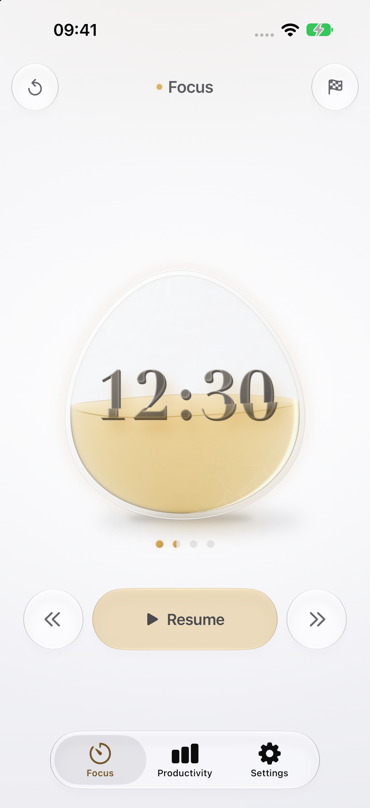
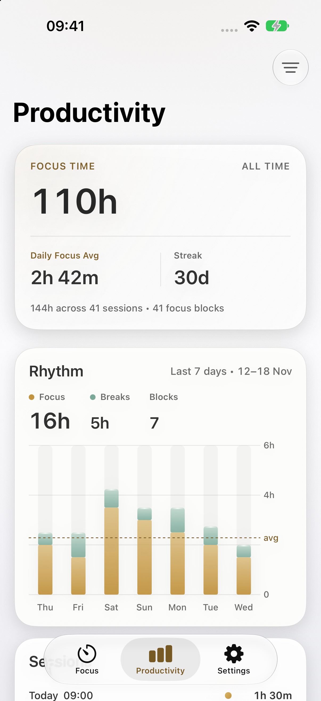
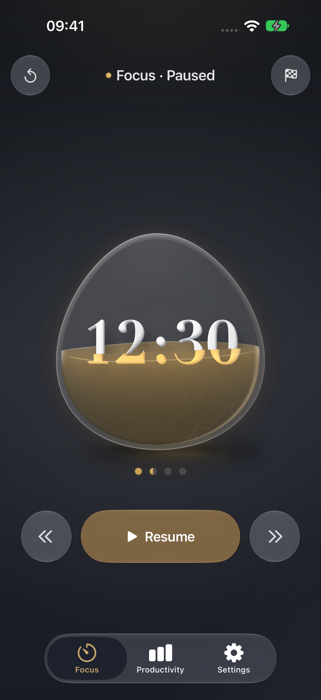
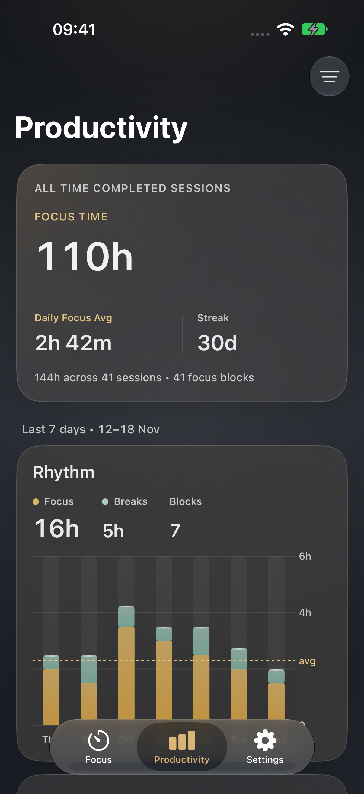
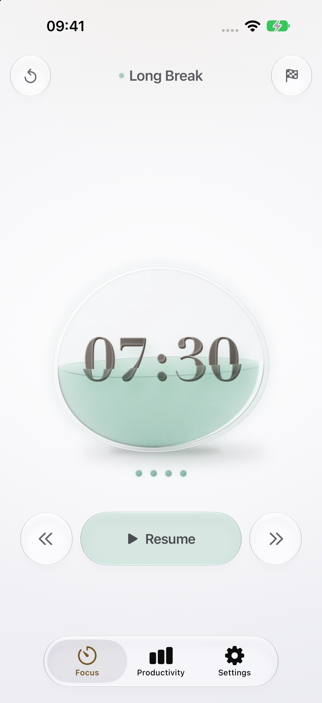
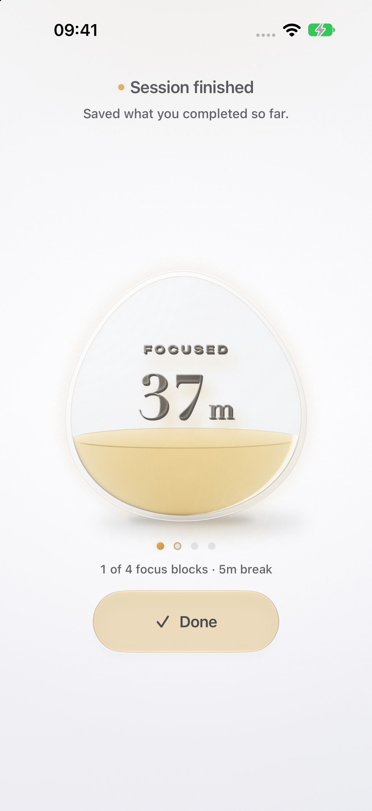

# Pomori

Pomori is an iOS Pomodoro timer I'm building in SwiftUI. The timer itself is a glass vessel that fills up as time passes. The whole focus and break cycle works. If the app gets closed mid-session, it reopens to the same session with the right time left, and finished sessions go into local charts.

I didn't write the code. AI agents did. I do the UI design and review what they build in the app. Many of the ideas are mine too, and I read up on SwiftUI along the way. [PRODUCT_VISION.md](PRODUCT_VISION.md) explains the design decisions.

## Screenshots

| Focus | Productivity | Settings |
| :---: | :---: | :---: |
|  |  |  |
|  |  |  |

Simulator captures from an iPhone 18 Pro on iOS 27.2, taken on 18 November 2026. The timer is paused on purpose, and the charts are filled with generated test data. The [full gallery](docs/screenshots/README.md) has the other phases and states, plus the commands to recreate them.

## What I focused on

A progress ring would have been simpler, but I wanted the timer to feel like an object sitting on the page. The glass vessel is where most of my time went. The first version looked nothing like glass. It looked fake. It took a long back-and-forth with the agents, and reference images I dug up myself, to get it to what you see here.

Each phase has its own shape. Focus is an upright amber drop, the short break is a pale bubble leaning upward, and the long break is broad and low. They all stand on the same baseline, so the vessel doesn't jump around when the phase changes.

| Short break | Long break | Finished early |
| :---: | :---: | :---: |
|  |  |  |

The Didot digits sit inside the glass, and a Metal shader lets the liquid tint and bend the part below the surface. The controls stay outside the glass, and tapping the background hides them along with the tab bar. When a session ends, the countdown turns into the focus total right there, and Done sets up the next session.

I also wanted the statistics to be easy to explain. If I skip a focus block after five minutes, those five minutes are kept, but the block doesn't count as completed. Paused time doesn't count at all. Productivity only counts a session once it's over, even if I finished early, and one that runs past midnight is split between the two days.

The all-time summary leads with Focus Time. Session Time also goes up when breaks run long, and I don't want a long break to make the main number look better. Below it, the Rhythm chart covers the last 7 days, 30 days or 12 months, and tapping a bar shows its numbers and sessions.

Settings uses one wheel for durations and rounds. Rhythm changes apply from the next session, so they never touch a timer that's already running. Everything else, like appearance or sound, applies right away.

| Rhythm setting | Choices |
| --- | --- |
| Focus | 15–90 minutes, in 5-minute steps |
| Short Break | 5 or 10 minutes |
| Long Break | 15, 20, or 30 minutes |
| Rounds | 1–10 |

By default a session is four 25-minute focus blocks with 5-minute short breaks between them, and it ends after a 15-minute long break.

## Run locally

The deployment target is iOS 26.2, and the screenshots were built with Xcode 27.2 (27B52). There are no package dependencies.

The repo used to be called VibePomodoro, and I haven't renamed the Xcode project yet. The project, scheme, source folder and bundle ID still use the old name.

1. Open `VibePomodoro.xcodeproj` in Xcode.
2. Select the `VibePomodoro` scheme and an iPhone simulator running iOS 26.2 or later.
3. Build and run. For a physical device, select your own signing team first.

The liquid shader needs Xcode's Metal Toolchain. If Xcode says it's missing, install it with:

```bash
xcodebuild -downloadComponent MetalToolchain
```

To build from the command line:

```bash
xcodebuild \
  -project VibePomodoro.xcodeproj \
  -scheme VibePomodoro \
  -configuration Debug \
  -destination 'generic/platform=iOS Simulator' \
  build CODE_SIGNING_ALLOWED=NO
```

To run the unit and UI tests on the simulator I used for the screenshots:

```bash
xcodebuild \
  -project VibePomodoro.xcodeproj \
  -scheme VibePomodoro \
  -destination 'platform=iOS Simulator,name=iPhone 18 Pro,OS=27.2' \
  test CODE_SIGNING_ALLOWED=NO
```

`xcrun simctl list devices available` lists the simulators you have. The tests cover session transitions, time accounting, recovery, history, persistence, reminder feedback and the main screen flows.

## How it works

One `PomodoroStore` holds the app's state. The engine decides what comes next in a session, and the screens just show the state and send actions. A running timer doesn't tick down a counter. It works out the time left from `targetEndDate` and the current time, so it stays right when the phone locks or the app goes to the background.

```text
VibePomodoro/
├── VibePomodoroApp.swift       Creates the single store
├── ContentView.swift          Shared shell and tab navigation
├── AppIcon.icon/              Icon Composer source
├── Core/
│   ├── Engine/                Session construction and transitions
│   ├── Models/                Settings, snapshots, archives, aggregates
│   └── Store/                 Runtime, persistence, notifications, feedback
├── Screens/
│   ├── Focus/                 Vessels, shader, controls, summary
│   ├── Productivity/          Summary, chart, session list
│   └── Settings/              Rhythm wheels and preferences
└── Shared/                    Reused theme and shell components
```

Everything is stored in UserDefaults for now. Settings, the active session, finished sessions and the statistics cache are written separately, so changing a setting doesn't rewrite the history. Clearing the history keeps the running timer and the settings.

The liquid surface redraws at most 12 times a second and the digits once a second. The surface only moves while the timer is running and Focus is on screen. Reduce Motion turns the movement off, and Low Power Mode drops the caustic light. There are also layouts for larger text, Increase Contrast adjustments, and VoiceOver labels for the chart and the session list.

## Current limits

- Everything stays on the device, and each device keeps its own timer.
- The earlier macOS and Live Activity experiments are shelved.
- Send Feedback and Share App still say Soon.
- The iPhone app is portrait only, because I haven't designed a landscape layout for Focus.
- I haven't measured rendering, heat or battery use on a real iPhone 14 Pro yet, and haptics and lock-screen notifications still need checking on a device. The simulator can't tell me any of that. Performance with a long history isn't measured either.
- Notifications are marked Time Sensitive, but that only works once the app is signed with a paid developer account. I sign it with a free personal team for now, so they arrive as normal notifications.
- SwiftData and iCloud sync aren't there yet. I want the time accounting and storage settled before I migrate any history. If I add iCloud, it will cover finished sessions and some settings, not a running timer.
- There are no imported sounds or advanced stats. An interface built around animated numbers is still just an idea, and the glass vessels are the design for now.
