# Screenshot gallery

All 21 screenshots are untouched simulator captures from an iPhone 18 Pro on iOS 27.2, taken on 18 November 2026. The sessions and history in them are generated test data. The [README](../../README.md) and the [design notes](../design-notes.md) each use a few of them.

## Capture environment

| Detail | Value |
| --- | --- |
| App source revision | `b2b141e1472d` |
| Build | Debug, `VibePomodoro` iOS scheme |
| Toolchain | Xcode 27.2, build 27B52 |
| Device | iPhone 18 Pro |
| Runtime | iOS 27.2 |
| Image size | 1206 × 2622 pixels, portrait |
| Appearance | Explicit Light and Dark launch overrides |
| Language and locale | English, `en_US` |
| Status bar | 9:41, Wi-Fi, full battery |
| Storage | Isolated `Qi.VibePomodoro.DocsPreview` UserDefaults suite |
| Notifications | UI-testing mode suppresses permission prompts; Settings uses the `allowed` permission fixture |

Rolling-window labels use the capture date, so the same fixtures show different dates on another day.

## Focus and breaks

Each phase is paused halfway through its step, so the liquid and the countdown hold still for comparison.

| Phase | Light | Dark |
| --- | :---: | :---: |
| Focus · 12:30 left in round 2 | 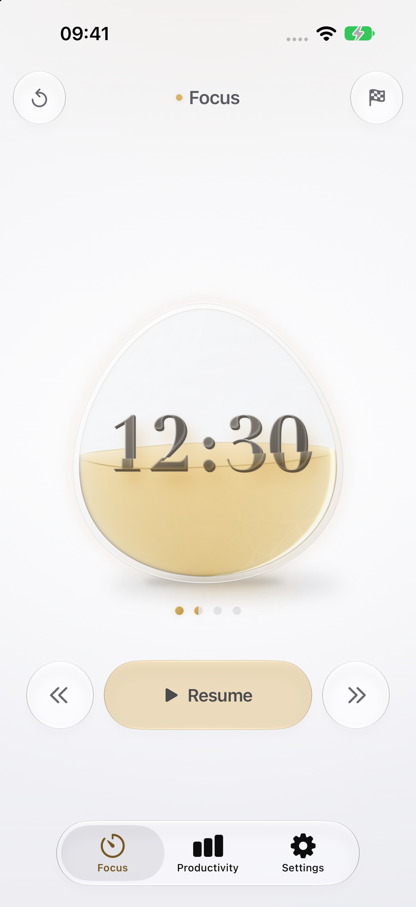 | 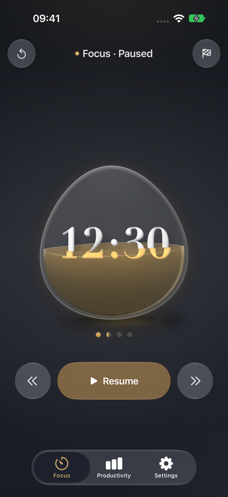 |
| Short Break · 02:30 left after round 1 | 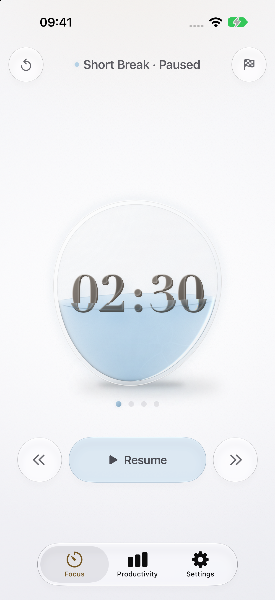 | 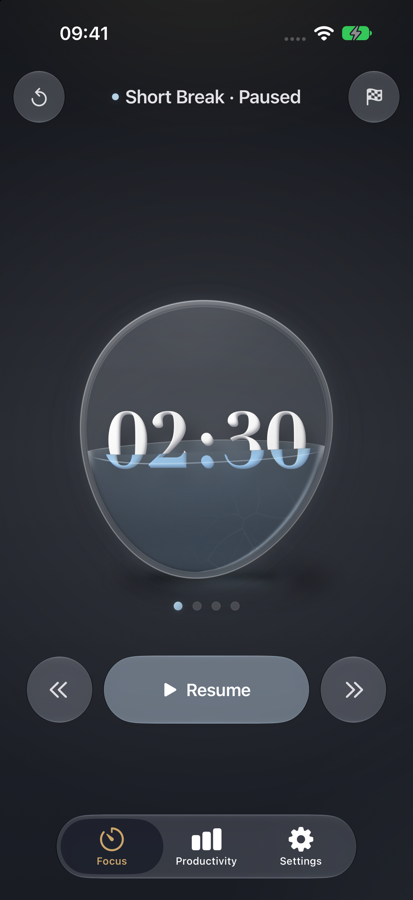 |
| Long Break · 07:30 left after round 4 | 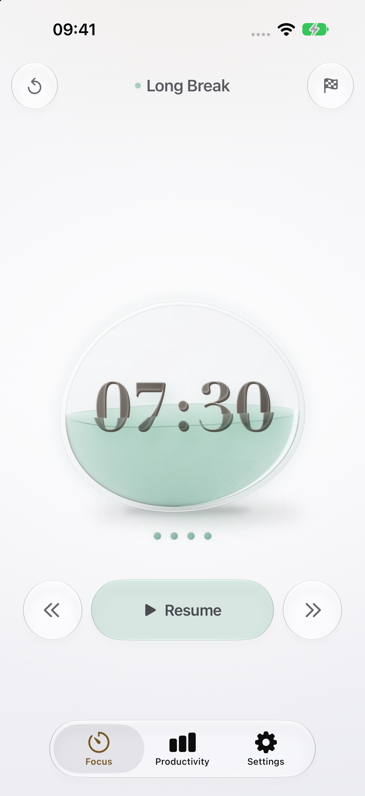 | 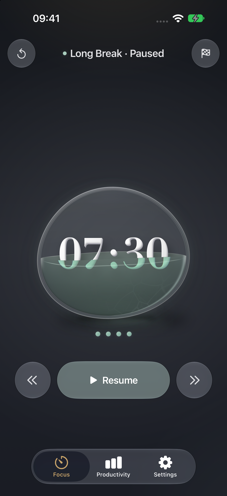 |

### Finishing and immersion

| Finished early · Light | Finished early · Dark | Immersive · Light |
| :---: | :---: | :---: |
| 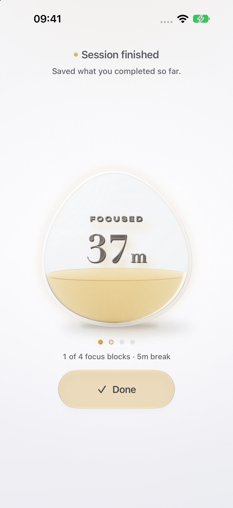 | 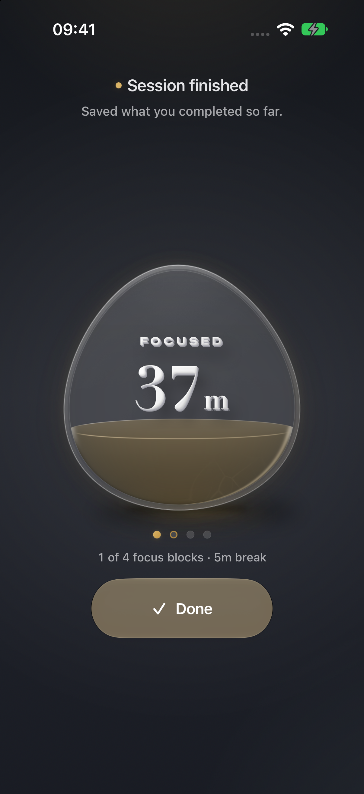 |  |

The completion images come from tapping Finish early in the Focus fixture above. That session has 37 minutes 30 seconds of focus, 5 minutes of breaks and one completed block, so the vessel reads 37m. VoiceOver reads the exact duration.

The immersive image is the same fixture after tapping the background, which hides the controls, status bar and tab bar.

## Productivity

The populated previews use the `long-extreme` UI-testing fixture, which generates 30 recent daily sessions and 11 older monthly ones. It's stress-test data, so some durations go past what the picker allows.

| Populated · Light | Populated · Dark | Rhythm and sessions · Light |
| :---: | :---: | :---: |
| 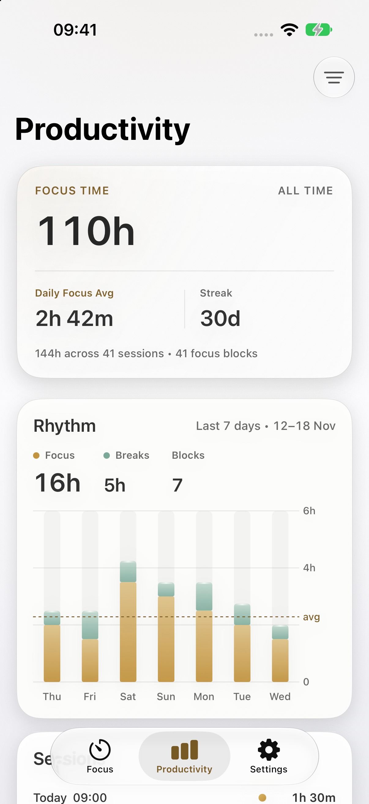 | 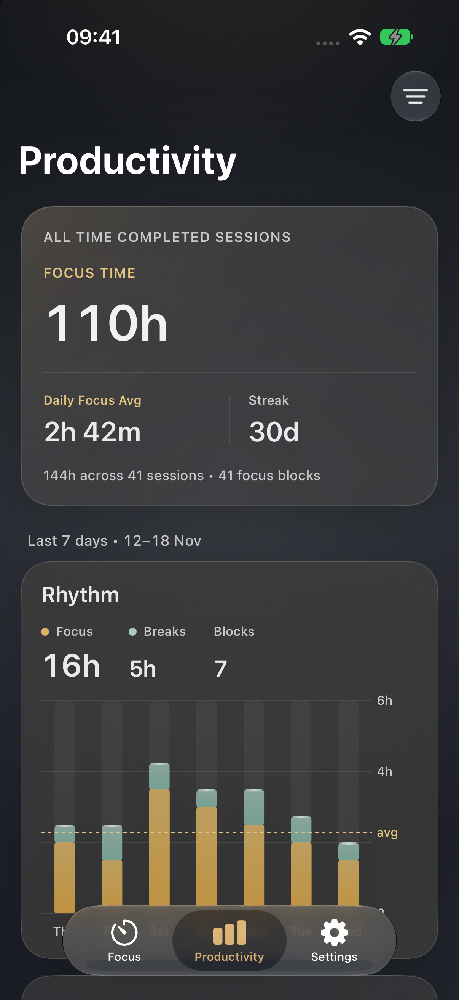 | 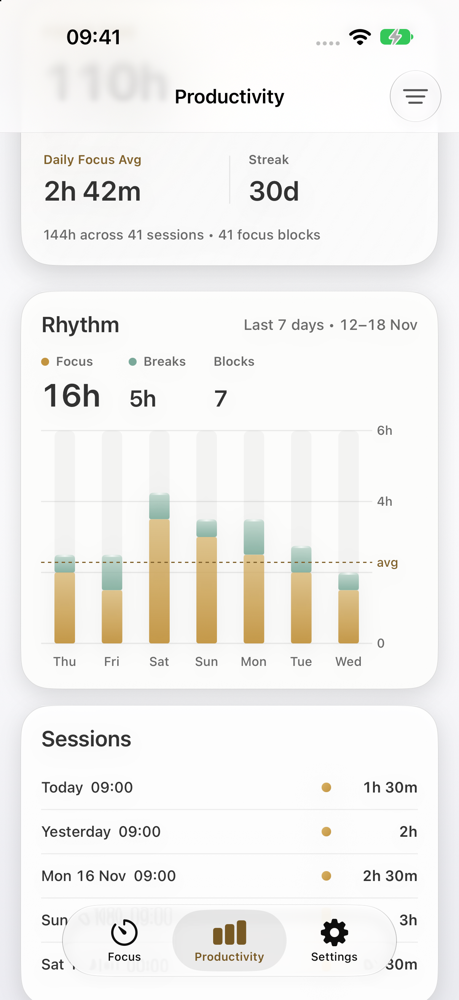 |

The overview images start at the top of the page. The detail image is scrolled down to Rhythm and Sessions.

### Ranges and selection

| Month | Year | Selected day |
| :---: | :---: | :---: |
| 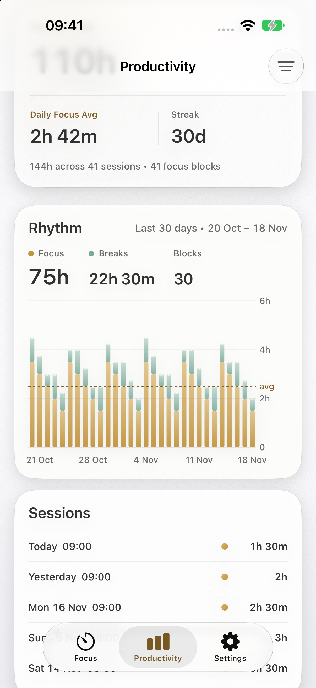 | 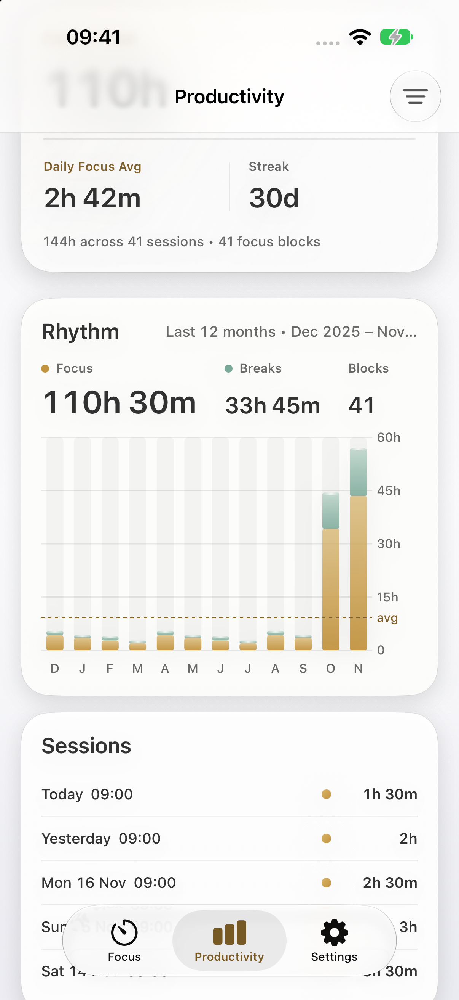 | 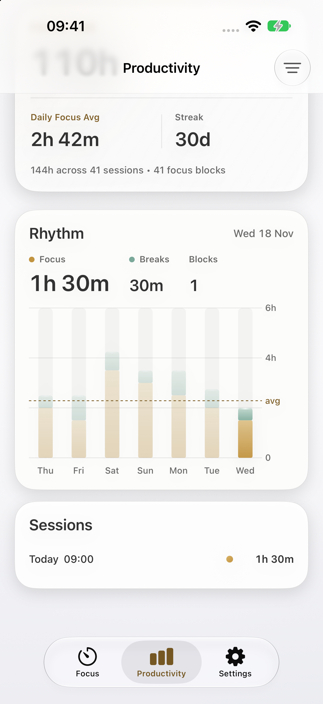 |

These three keep the detail view's scroll position. The selected day is 18 November in Week, with its one session listed below the chart.

### Empty history

| Light | Dark |
| :---: | :---: |
| 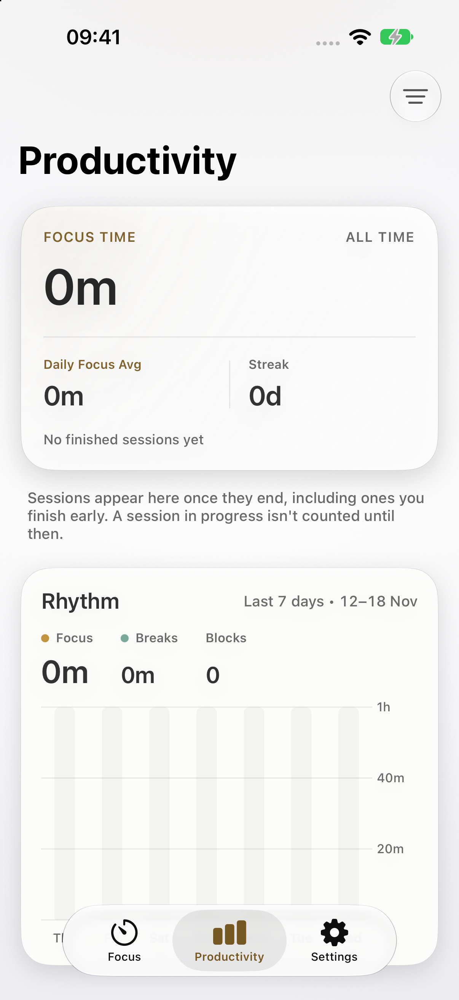 | 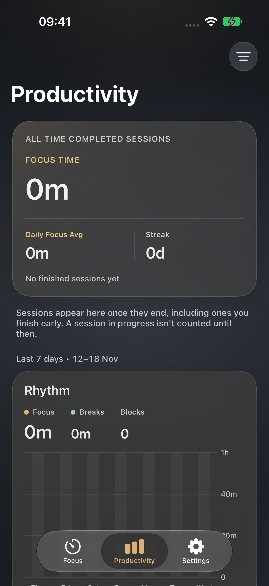 |

These launches reset the preview suite and load no history, so every total is zero and Daily Focus Avg shows a dash.

## Settings

| State | Light | Dark |
| --- | :---: | :---: |
| Default rhythm and preferences | 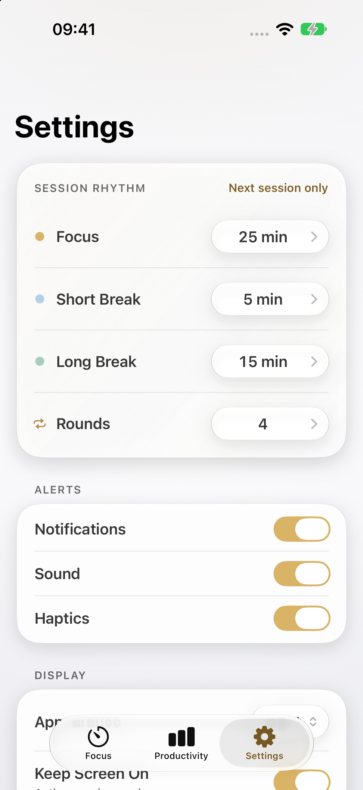 | 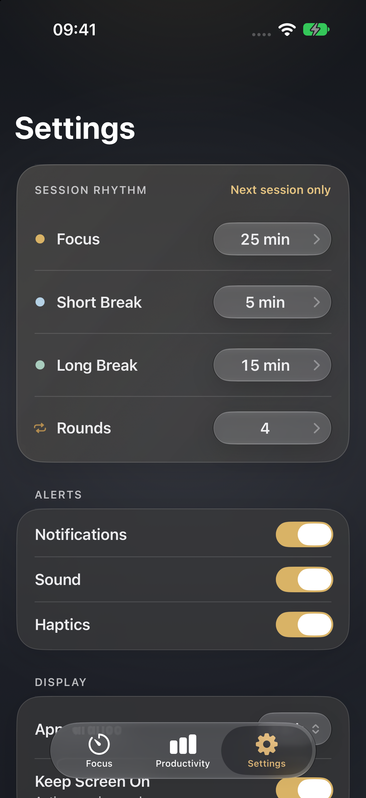 |
| Focus wheel expanded | 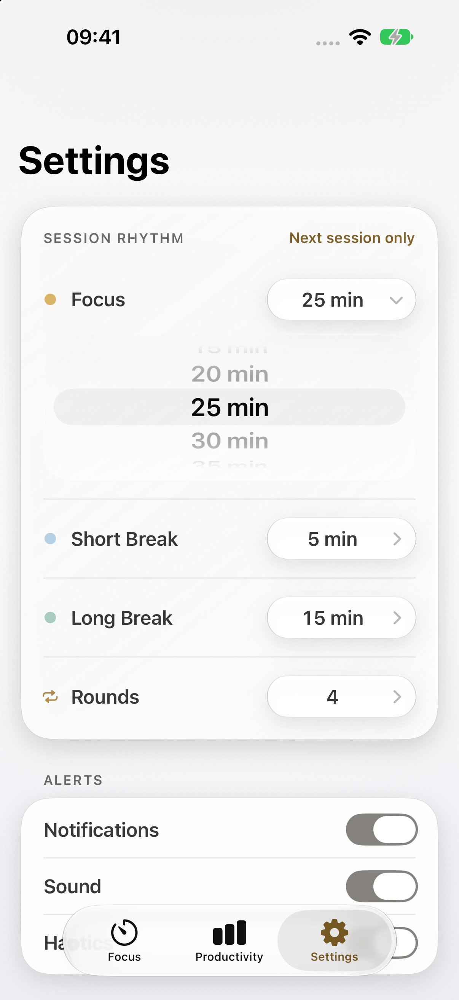 | 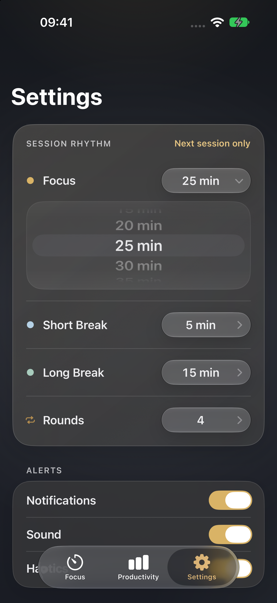 |

Settings shows the default rhythm, 25 / 5 / 15 minutes and four rounds, with alerts on and notification permission simulated as allowed. Display and Other are further down, out of frame.

## Reproduce the captures

Run these from the repository root. `DEVICE_ID` is the simulator I used. On another machine, pick one from `xcrun simctl list devices available`.

```bash
DEVICE_ID=19E643F3-B20D-4E3F-8877-4FE065C4EAE1
BUNDLE_ID=Qi.VibePomodoro
PREVIEW_SUITE=Qi.VibePomodoro.DocsPreview
```

Build, boot and install the app. Skip `boot` if the simulator is already running.

```bash
xcodebuild \
  -project VibePomodoro.xcodeproj \
  -scheme VibePomodoro \
  -configuration Debug \
  -destination "platform=iOS Simulator,id=$DEVICE_ID" \
  -derivedDataPath /tmp/Pomori-docs-build \
  build CODE_SIGNING_ALLOWED=NO

xcrun simctl boot "$DEVICE_ID"
xcrun simctl bootstatus "$DEVICE_ID" -b
xcrun simctl install "$DEVICE_ID" \
  /tmp/Pomori-docs-build/Build/Products/Debug-iphonesimulator/VibePomodoro.app

xcrun simctl status_bar "$DEVICE_ID" override \
  --time '9:41' --dataNetwork wifi --wifiMode active --wifiBars 3 \
  --batteryState charged --batteryLevel 100
```

Set the isolated defaults suite before `--reset-vibe-store`, because that flag clears whichever suite is selected. The helper below does that, closes the previous launch, and sets the appearance, language and notification fixture:

```bash
preview() {
  local appearance="$1"
  shift
  xcrun simctl terminate "$DEVICE_ID" "$BUNDLE_ID" 2>/dev/null || true
  SIMCTL_CHILD_VIBE_DEFAULTS_SUITE="$PREVIEW_SUITE" \
  SIMCTL_CHILD_VIBE_NOTIFICATION_PERMISSION=allowed \
  xcrun simctl launch "$DEVICE_ID" "$BUNDLE_ID" \
    --ui-testing --reset-vibe-store "--appearance-$appearance" \
    -AppleLanguages '(en)' -AppleLocale en_US "$@" || return
  sleep 10
}
```

Launch the paused Focus fixture and capture it. The helper waits ten seconds because shorter waits sometimes caught a blank launch frame or a half-finished appearance change. Check each image before replacing a screenshot, and wait longer if the page hasn't settled.

```bash
SIMCTL_CHILD_VIBE_FOCUS_FIXTURE=focus-2-0.5 preview light
xcrun simctl io "$DEVICE_ID" screenshot docs/screenshots/focus-light.png
```

Repeat with `dark` and the matching filename. Focus fixtures are written `<phase>-<round>-<progress>`, and a trailing `-running` leaves the timer running.

| Screenshot stem | Fixture or launch recipe |
| --- | --- |
| `focus` | `VIBE_FOCUS_FIXTURE=focus-2-0.5` |
| `short-break` | `VIBE_FOCUS_FIXTURE=shortBreak-1-0.5` |
| `long-break` | `VIBE_FOCUS_FIXTURE=longBreak-4-0.5` |
| `focus-finished` | Launch the Focus fixture, tap Finish early, confirm, and let the summary settle. |
| `focus-immersive-light` | Launch the light Focus fixture and tap the background outside the vessel. |
| `productivity` | `VIBE_PRODUCTIVITY_FIXTURE=long-extreme`, with `--open-productivity`. |
| `productivity-empty` | No fixture, with `--open-productivity`. |
| `productivity-detail-light` | Launch populated Week in light mode and scroll to Rhythm and Sessions. |
| `productivity-selected-light` | In that detail view, tap the last day, 18 November in this capture. |
| `productivity-month-light` | Open Time Range and choose Month, retaining the detail scroll position. |
| `productivity-year-light` | Open Time Range and choose Year, retaining the detail scroll position. |
| `settings` | No session or history fixture, with `--open-settings`. |
| `settings-picker` | `--open-settings --expand-focus-settings-picker`, which opens the Focus wheel at 25 minutes without a tap. |

With `simctl`, app environment variables need the `SIMCTL_CHILD_` prefix. For example, populated Productivity, empty Productivity and Settings:

```bash
SIMCTL_CHILD_VIBE_PRODUCTIVITY_FIXTURE=long-extreme \
  preview light --open-productivity
xcrun simctl io "$DEVICE_ID" screenshot docs/screenshots/productivity-light.png

preview light --open-productivity
xcrun simctl io "$DEVICE_ID" screenshot docs/screenshots/productivity-empty-light.png

preview light --open-settings
xcrun simctl io "$DEVICE_ID" screenshot docs/screenshots/settings-light.png
```

A fixture only applies to its own launch, so the next preview starts clean. For other permission states, change `allowed` in the helper to `denied` or `notDetermined`.

Afterwards, check the images, their size and the Markdown paths, then clear the status-bar override:

```bash
xcrun simctl status_bar "$DEVICE_ID" clear
```
